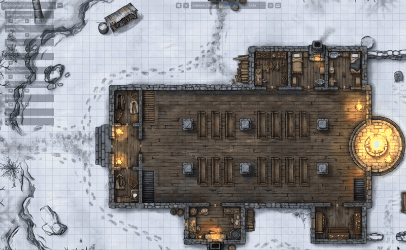

# foundry-my-modules

Small Foundry VTT fixes for one table, in one module. Requires Foundry VTT 14.

Players see Table Tools in their Foundry client language (English or German), including safety messages sent by someone using the other language. Module settings and GM-only tools use English.

## Install

Install the module from its manifest URL:

```
https://github.com/echo8134/foundry-my-modules/releases/latest/download/module.json
```

Foundry offers each new release through the module's Update button.

## Features

<details>
<summary><h3>Appraise and harvest a corpse (dnd5e)</h3></summary>

Target a dead creature. Use **Appraise** or **Harvest** on the Harvesting Kit, or open the harvesting tool in the token controls with your character selected. The active GM must be online. Appraisal takes one attempt per corpse and requires training in the creature's skill. Success whispers the parts, DCs and dangers to the appraiser, and helps another character harvest the same corpse.

The GM reviews the Dexterity roll, chooses the kill condition, marks destroyed parts and can leave successful parts behind. Confirming spends one charge, copies the gained world items to the harvester, posts any danger and saves, and closes this corpse to further harvesting. A missing or empty kit requires skill proficiency and gives disadvantage. If an approved handoff is interrupted, use **Harvest** again with the original character to finish it. A disabled effect records each appraisal or confirmed harvest for that token. The kit records the charge used for each confirmed harvest.

As GM, right-click a dead creature with a valid harvest table to see its status. Click the checkmark to reopen that token for another harvest. The reset preserves earlier loot, kit charges and chat messages. A successful appraisal still helps the next harvester.

Character sheets store Harvesting Kit training under **Tool proficiencies**. Existing kits with proficiency set on the item also work. The two kit activity IDs are `AppraiseCreature` and `CheckKitSupplies`.

The creature's actor supplies `flags.foundry-my-modules.harvest` with `appraise: {skill, dc}`, `size`, and a `components` array. Each component has an `id`, `name`, `dc`, `edible`, `quantity`, and `item` (exact world Item name or `Item.<id>` UUID). A danger carries `text` and optional `save: {ability, dc}` and `damage: {formula, type}`. Components with the same `exclusiveGroup` represent alternatives. The highest successful DC wins, with table order breaking ties. Macros can call `game.modules.get("foundry-my-modules").api.harvesting.request("harvest", actor)`.

</details>

<details>
<summary><h3>Identify and gather herbs (dnd5e)</h3></summary>

As GM, create a world Item for each specimen the plant can yield. Create an NPC for the plant and place its token on the scene. For example, after creating a plant named **Silverleaf patch** and a world Item named **Silverleaf**, run this script macro as GM:

```js
await game.actors.getName("Silverleaf patch").setFlag("foundry-my-modules", "herbalism", {
  identify: { skill: "nat" },
  components: [
    {
      id: "leaves",
      name: "Silverleaf",
      item: "Silverleaf",
      quantity: 2,
      dc: 15,
      danger: { text: "The leaves release a cloud of stinging pollen." }
    }
  ]
});
```

Use an exact, unique world Item name or an `Item.<id>` UUID. Instead of `dc`, set `rarity` to `common`, `uncommon`, `rare`, `veryRare`, or `legendary` for DC 12, 15, 18, 21, or 24 respectively. Set the DC for a signature herb yourself. For a hostile biome, you can raise it by 2 to 5. Use the source Item to describe the herb’s purpose (quest, trade or recipe), price, and any preparation or direct-use effect. The campaign allows one active herb effect per creature. For an Item with limited uses, set `charges: "1d4"` on the component to roll charges when it is gathered. A superior specimen can gain an extra charge, an extra portion, or a higher trade value at the GM's discretion.

Hover over the plant token, press **T** to target it, then open the herbalism tool in the token controls, or use **Identify** or **Gather** on the campaign kit. Identify is optional and available once per token. Choose Nature, Medicine, or the kit. The default DC is 15 plus the intended gatherer's proficiency bonus. If another character will gather, select them before identifying. To override the DC, set `identify.dc` on the plant. Success reveals the components' DCs and hazards and gives a trained gatherer with a charged kit advantage.

Gather with Wisdom (Survival) or Intelligence (Nature). With a charged kit, add the character's herbalism proficiency. With an empty or missing kit, roll the matching skill at disadvantage, even if untrained. The GM reviews the roll. Meeting a component's DC yields its specimen. Beating it by at least 5 yields a superior specimen. A miss by up to 5 with a kit yields nothing. A larger miss, or any kitless miss, triggers the herb's hazard.

Each plant token gets one Gather roll. If the GM closes the review, the original gatherer can use **Gather** again to reopen the same result, including after a reload. Confirmation spends one kit charge and awards the approved specimens. Each charge-bearing specimen has its own uses. If delivery is interrupted, use **Gather** again to finish it.

Set the kit’s maximum uses to 10 and leave use recovery empty. The campaign kit costs 50 gp, weighs 7 lb., and holds ten charges of vials, pressing paper, and preservation salt. For a 40 gp refill, settle the payment and restore all ten uses on the kit sheet.

</details>

<details>
<summary><h3>Hide cursors</h3></summary>

Hover a player’s row in the player list at the bottom left to see its cursor toggle. GMs also see toggles on GM rows.

- On your own row it hides your cursor from everyone, for example the GM's while preparing a reveal.
- On another row it hides that person's cursor from you only. Shift-click applies the same choice to all other users whose cursors you can toggle.
- Pings still show. The choice is stored per user, so it follows you to every device.

</details>

<details>
<summary><h3>Every level in the level navigation</h3></summary>

The client setting "Show every level" lists all levels of a scene under the scene name, instead of three rows and a scroll bar. The client setting "Levels as a dropdown" folds the list into one row that names the current level; a click on it folds the list out and in. Both are off by default.

A GM can save a camera center and zoom for each floor. Pan and zoom to the desired view, right-click the current level in scene navigation, and choose **Save view for this level**. For a single-level scene, right-click the scene name. When an alternate map variant is active, **Save view for this variant** gives it its own framing. Everyone viewing the floor sees its saved view on entry and can then pan and zoom freely.

Variants without a saved view use the level view. Use **Clear variant view** or **Clear level view** in the same menu to remove a preset. Floors without either preset use Foundry's usual camera behavior.

</details>

<details>
<summary><h3>Scene variants at their level</h3></summary>

A scene can carry variants of its levels, such as feast, night, burning or ruined. The GM switches them in the level navigation; players see nothing of it.

- The client setting "Variants at their levels" shows them as arrows (`◀ Burning ▶`) or as a tree under each level.
- A click switches the variant on that level only. Shift-click switches it on every level that has it, so the fire takes the tower too.
- A click on the base state resets that level; Shift-click resets every level.



</details>

<details>
<summary><h3>Names for generic figures</h3></summary>

A token of a villager, a guard or a hunter gets its own name when the GM puts it on the scene, drawn from RollTables the GM keeps in Foundry.

- Give the actor the flag `flags.foundry-my-modules.randomName = { tables: ["<RollTable UUID>", ...] }`. With several tables each is equally likely, so a guard can carry the names of two cultures.
- Only unlinked tokens are named, and only when the GM creates them with the prototype's name. A linked NPC, an actor without the flag and a token created with its own name keep their name.
- No two tokens on a scene get the same name while the tables have names left, also when several tokens are created at once.
- The world setting "Format of random token names" shapes the name: `{name}` is the drawn name, `{actor}` the prototype token's name, so `{name} ({actor})` gives "Bogdan (Guard)".
- The dice button in the token HUD rolls a new name. `api.rollName(actor)` returns one for macros.

</details>

<details>
<summary><h3>Safety tools</h3></summary>

Open the card icon below **Quests**. The GM can enable each of the following tools independently in the world settings. All four start enabled.

- Choose **Pause** to show everyone the X-card and post its public chat message. To add a private note, expand **X-card**, enter up to 200 characters, then click **Pause**. Only the active GM receives the note. Each of their tabs keeps its ten latest notes until it reloads.
- Choose **Fast-forward** to skip a passage or **Rewind** to revisit it. Everyone sees the signal, even with the safety window closed and a character sheet open.
- Choose **I need a break** to post a break request to public chat under your own name.
- Expand **Lines & veils** to read or add a boundary. Use a line for a topic to leave out, or a veil for something that can happen off screen. GMs can edit or remove entries.

Table signals and X-cards play a short tone at your interface volume. Turn off **Safety alert sound** in your client settings to mute it.

Table signals, X-cards and list changes need an active GM. The signals, X-card, public X-card chat message and saved list omit the contributor’s name. Foundry 14 sends the contributor’s user ID to the relay GM at the socket level, where a GM with developer tools can inspect it. Other players receive only the GM’s public result. The relay handles each request once across the active GM’s open tabs.

</details>

<details>
<summary><h3>Clickable tiles</h3></summary>

To give a portrait a sound or link a note to a quest, open the tile's configuration as GM. On the **Appearance** tab, find **My Modules**. Set either or both fields and save. Clear a field and save to remove that action.

- **Click sound** takes an audio file. A single left click plays it at the clicking user's interface volume. Clicking again restarts it from the beginning.
- **Quest UUID** takes the world journal UUID, such as `JournalEntry.<id>`. A click opens the quest sheet for anyone who can view that quest.

- **Calendar sheet** draws the current month over a blank parchment tile, with past days crossed out and today marked in red. The marks follow the world clock. A Harptos month displays its festival after the last tenday. Use the bundled `modules/foundry-my-modules/assets/quests/parchment.webp` as the tile texture.

Test the tile on the token layer, where players use it. A hand cursor appears when the tile has an action you can use. On the Tiles layer, you can select, drag, or double-click the tile to configure it. Creation tools also work over the tile.

Transparent pixels let clicks through, and overlapping tokens keep their normal controls. To put an invisible hotspot over artwork, set the tile's opacity to zero. Its entire rotated rectangle then responds to clicks.

Scripts can set the same fields on a Tile document with `flags.foundry-my-modules.clickSound` and `flags.foundry-my-modules.quest`.

</details>

<details>
<summary><h3>Quest log</h3></summary>

Click **Quests** (the scroll icon below Notes on the left) to open the **Quest Log**. GMs and players can open it while keeping their current canvas tool selected. You can also use the button at the bottom of the Journal directory or press **Ctrl+Q**. Choose a status tab, then click a quest to read it. Each pinned note counts the objectives you can see, including child objectives.

As GM, click **Create quest** to start a hidden quest in the journal folder named by the world setting **Quest journal folder** (default `Quests`). Set its status on the sheet or right-click its note on the board. The trash button asks for confirmation before deleting the journal.

- Edit the name, giver, and objectives directly on the sheet. Drop an Actor onto the giver section to use its name and portrait, or choose a portrait with the image picker.
- Use the checkbox to mark an objective done and the eye to hide it. Drag the grip to reorder objectives. Indent a goal beneath the preceding goal, or outdent it to return it to the top level.
- Players see the description directly below the quest header, followed by objectives and rewards. Without a portrait or giver, the status and primary quest star sit beside the title. Use the pencil to edit a page. New quests also have a GM notes page. Open sheets update when the journal changes.

#### Rewards, personal quests, and the tracker

- Drop an Item from the sidebar or a compendium onto the quest sheet, or click **Add text reward** and edit the line. New rewards start locked. Use the eye to hide a reward or the lock to release it. Players can drag an unlocked Item onto their character sheet. For compendium Items, they need access to the source pack. Text rewards stay on the quest sheet.
- Click the eye in the quest header to open the sheet for connected players who can view it. Each player sees their own objectives, rewards and pages.
- At the bottom of the sheet, select the players who may see a personal quest. Clear every selection to share it with the whole party. The **Hidden** status keeps it GM-only.
- Choose a **Parent quest** to list this quest and its status on the parent’s sheet. Click a sub-quest there to open it. The board groups related quests together in each status tab.
- Mark a **Primary quest** on its sheet. Choosing another transfers the star. **Ctrl+Shift+Q** opens the primary quest for anyone who can see it.
- Click **Quest Tracker** on the board or press **Ctrl+Alt+Q** to show or close the panel. It lists active quests and their unfinished objectives. Click a quest title to fold its objectives, or drag the panel by its title bar. Each browser remembers the position and folded quests for each player in the world.

#### Write a quest from a script

Create an ordinary `JournalEntry` with `flags.foundry-my-modules.quest`. The [quest specification](docs/quests-spec.md#data-model) describes the flag fields. A quest's ownership follows its data, so the GM client reverts manual ownership edits. Hidden quests are GM-only. Other statuses grant Observer to the users listed in `personal`, or to every player when the list is empty.

Keep objective and reward IDs stable across imports. Omit `done` and `hidden` to keep the GM's values for matching objective IDs, including children. For rewards, omit `hidden` and `locked` to preserve those values by ID. Always write the whole `objectives` or `rewards` array. An index path such as `objectives.0.done` makes Foundry replace the array and drop the other objectives.

Hidden objectives and rewards are filtered from the interface. Foundry sends world documents to clients, so players can inspect those flag values outside the sheet.

```js
const quests = game.modules.get("foundry-my-modules").api.quests;
await quests.open();
const [first] = quests.list(); // Plain quest data visible to the current user
if (first) await quests.openQuest(first.uuid);
```

</details>

<details>
<summary><h3>Chat dice tray</h3></summary>

Click a die beneath the chat input to add it to the roll. The count above each die follows your draft. Shift-click to enter a quantity. Ctrl-click or Cmd-click rolls one die immediately and keeps your draft in the editor.

Use the rightmost dice button to submit the draft with the tray's modifier. For a sum with one d20, **ADV** rolls two d20s and keeps the higher result. **DIS** keeps the lower result.

</details>

<details>
<summary><h3>GM soundboard and macro hotbar</h3></summary>

Create a playlist named **Soundboard** and add your sound effects. Open the Playlists sidebar and click a parchment button below the playlists. Everyone hears that sound once at its configured volume through their interface audio channel. Click the same button again to stop it for everyone.

Use the world setting **Soundboard playlist name** to choose another playlist. Turn off **Show GM soundboard** to hide the panel.

Press **Alt+B** or click the keyboard icon in the Token controls to hide or restore your macro hotbar. The **Hide macro hotbar** client setting remembers your choice for this GM in this browser. The docked action HUD moves into the space you free. Players keep their own hotbars.

</details>

<details>
<summary><h3>Action HUD for D&D 5e</h3></summary>

Select a token you own to see its combat actions above the macro slots. The GM can use any token. If you select several, the bar follows the first. **Alt+H** toggles **Show action HUD** for your client.

Players have **Always show my character’s action HUD** enabled by default. When the first selected token is yours, the HUD shows its actions. Otherwise, it shows your assigned character if you own it, even on a scene without that character’s token. Players can turn this off in their client settings.

The tabs and macro slots share a frame by default. To move the HUD separately, turn on **Detach action HUD from hotbar** and drag the actor's name. Double-click the name to reset its position. Turning off the setting docks the tabs again. Updating the module preserves a saved layout choice.

Use **Action HUD design** to switch from **Wood and parchment** to **Foundry menus** in this browser. The Foundry menu design follows your interface theme and applies to both layouts, including the shared frame when docked.

Turn on **Show active effects above the Action HUD** to see your character’s active spells and conditions. The highlighted concentration entry shows the spell name and its remaining duration, when known. Click it to end the spell on all linked targets. Hover over an effect for details, or right-click another effect to end it or remove one level of a condition such as Exhaustion.

Open **Action HUD** in the module settings and choose **Visible action categories** to select your tabs. **Conditions** and **Rests** start hidden. Each player can choose their own categories.

Click a group to open it and click it again to fold it away. **Attacks**, **Spells**, **Features**, and **Items** use the item through dnd5e. The attack list shows equipped weapons and other usable items with an attack activity. The spell list starts with cantrips and groups spells by level. Spells with the at-will, ritual, innate, or pact casting method appear even when unprepared. Slot counts, uses, and quantities update as you play. Right-click an item to open its sheet.

Each item shows the attack bonus or save DC, damage or healing, range, and area of its first usable activity where applicable. Hover over the item or focus it with the keyboard to see its other activities.

**Checks/Saves** shows modifiers for ability checks, saving throws, and skills. **Conditions** toggles dnd5e effects. Click Exhaustion to add one level or right-click it to remove one. **Rests** starts a short or long rest. At 0 HP, click the skull in the bar to roll a death save. It uses the same roll and privacy settings as the character sheet. The button disappears when you stabilize, die, or regain HP. Hide it with the **Death Saves** category. Shift-click to skip the configuration dialog where dnd5e supports it.

The **Show death save counters** world setting is off by default. Enable it to see ongoing saves beneath tokens as GM, regardless of the selected token or the Party Glance ring. Players see their skull button, successes (✓) and failures (×) together above their character’s Action HUD. Turning off the counters returns the skull to the main HUD bar. The **Private death saves** house rule applies in either layout.

</details>

<details>
<summary><h3>Party Glance token ring for D&D 5e</h3></summary>

As GM, select a player character's token to see small badges around it with its armor class, passive Perception, hit points and more, so you do not have to open the sheet. Players never see the ring. The badges keep the same size at every zoom level, follow the token while it moves, and show a tooltip with the full value when you hover over them.

Open **Party Glance** in the module settings and choose **Configure token ring**. Only the GM sees the button, and the layout is a world setting.

- **Slots on the ring** sets 1 to 8 badges. Each count has one fixed layout. Slot 1 sits on top and the rest follow clockwise. The preview shows the numbered slots, and clicking one jumps to its row.
- **Ring distance** moves the preview badges closer to or farther from the token as you drag. The default of 100% uses the original spacing. Click **Save** to apply the distance on the map.
- **Show the ring** picks when it appears: when you select a token, when you hover a token, or on every player token while a combat is running. Outside a started combat the last choice behaves like selecting.
- **What each slot shows** has one dropdown per slot. Leave a slot empty to leave a gap. Choose **Passive skill** or **Saving throw** to pick the skill or ability in a second dropdown. **Custom value** reads any number, text or true/false value from the actor, for example `system.abilities.san.value`, and shows it under the short name you enter. Slots above the chosen count keep their choice for later.
- **Player-owned characters** and **Friendly NPCs** choose which tokens get a ring. A friendly NPC is a token with the friendly disposition and no player owner.
- **Short labels** adds AC, PP and similar labels to every badge. Saving throws, passive skills and custom values always show theirs.
- **Temp HP on the HP badge** adds the temporary hit points in blue.

A badge for something the character does not have, such as a spell save DC for a fighter or darkvision for a human, shows a faded dash. Concentration and Heroic Inspiration glow when active, and the concentration tooltip names the spell.

</details>

<details>
<summary><h3>Private death saves for D&D 5e</h3></summary>

In the module’s world settings, select the GM who receives **Private death saves**. This enables the house rule and adds a **House rules** journal with a page the whole table can read.

When you roll a death save for your character, only you and the selected GM see the result in chat. The same rule applies when you skip the dialog. Other players see that someone rolled privately.

D&D 5e tracks successes, failures, and recovery as usual. On a player character’s sheet, the assigned player and the selected GM can see the death save counters. If nobody is assigned to the character, its player owners can see them. Foundry still sends the actor data to clients with sheet access.

</details>

## Variant data

A variant is a set of documents (Tile, AmbientLight, AmbientSound, Wall, or Token) with the flag `flags.foundry-my-modules.variant`.

- The flag is a variant name, or a list of names: the document is on while any of them is active. The base state's name means "on in the base state", so `["Day", "Feast", "Night", "Burning"]` is a wall that only the ruin removes. Variants leave documents without this flag alone.
- A token belongs to the scene level in its `level` field. Other documents use their `levels` field and belong to every level when it is empty.
- The variants of a level are the base state, then the variant names of its documents in the order the documents were created. The scene flag `defaultName` names the base state. If you omit it on a scene with variant tokens, the module saves the active GM's localized base name so players in other languages use the same name. On older scenes with no stored base name or selection, players see variant tokens once the GM first opens the scene or selects a variant.
- The scene flag `active` maps a level id to its active variant. A level missing from it shows the base state.
- Switching off saves the switched fields in the document flag `restore` and writes the off values: Tile `alpha` 0, light and sound `hidden`, Wall `move`, `sight`, `light` and `sound` 0. Switching on writes the saved values back and deletes the flag. Tiles switch by alpha, because the GM sees hidden tiles half transparent.
- Create tiles, lights, sounds, and walls switched on. The active GM applies the stored variant when the scene loads and whenever the flags change.
- Give a token its usual visibility when you create it. The module stores that choice in `flags.foundry-my-modules.gmHidden`. A new tagged token arrives hidden. The active GM reveals it when its variant is active and the saved choice permits it. Older tokens use their saved `restore.hidden` value or, if absent, their original visibility.
- Use the eye in the token HUD while its variant is active. The Hidden checkbox in token configuration also changes the saved choice while its variant is off. A normal paste preserves it. Pasting as hidden sets it. Removing the last variant tag restores the saved choice.
- Any GM can switch a variant. The active GM hides outgoing tokens and their attached Regions, publishes the new selection, then reveals incoming tokens. Tokens outside their variant disappear from the canvas for everyone and lose their selection and targeting. In its active variant, a manually hidden ambush stays translucent for the GM and hidden from players.

The API for macros and other modules:

```js
const api = game.modules.get("foundry-my-modules").api;
api.getVariants(scene); // [{ levelId, name, variants, active }]
await api.setVariant(scene, levelId, "Burning"); // this level only
await api.setVariant(scene, levelId, "Burning", { linked: true }); // every level that has it
await api.setVariant(scene, null, "Day"); // reset every level
api.rollName(actor); // a name from the actor's name tables, or null
```

## Develop

- `npm run check` lints with Biome.
- `npm run e2e` runs the end-to-end tests against a running Foundry world, with a Gamemaster and a player browser. Set `FOUNDRY_URL`, `FOUNDRY_WORLD`, `FOUNDRY_USER` and `FOUNDRY_PASSWORD`. The tests write to the world, so point them at a world kept for tests.

## Release

End each pull request description with `## Release notes`. Write one bullet per change a GM or player will notice. For example:

```markdown
## Release notes

- Players can open the quest log with Ctrl+Q.
```

For an internal change, write `- N/A` under the heading. If you push a change directly to `main`, you can put the same section in the commit message. The release includes the collected notes and a link to the full history.

Merging a change to the module manifest, scripts, styles, translations or bundled assets into `main` publishes an update automatically. Fixes and small features advance the patch version, for example from `v0.9.1` to `v0.9.2`. Documentation and test changes alone skip publication.

Link each issue the PR resolves with `Closes #123` in the PR description. For a larger feature, add `release:minor` to its issue before merging. If any module change in the release closes an issue with that label, the version advances from, for example, `v0.9.1` to `v0.10.0`. Issues labeled only `bug` or `enhancement` use the default patch bump. Without an issue, you can still request a minor release with a commit or PR title such as `feat: [minor] add a quest board` or `feat(quests): [minor] add a quest board`.

The release notes link the issues resolved by the module changes. After publication, the workflow comments on each of those issues with the release tag. If a run is interrupted, the next run checks the published release and adds any missing comments.

To choose a higher version, such as a major release, set it in both `module.json` and `package.json` in the same PR. The workflow stamps the published manifest and its copy inside `module.zip` with the release version. Foundry checks the stable manifest URL and downloads the ZIP for that exact version.

## Credits

The Fast-forward and Rewind signals adapt _Script Change_ by Beau Jágr Sheldon for Foundry VTT. [Script Change RPG Toolbox](https://briebeau.com/scriptchange) · [CC BY 4.0](https://creativecommons.org/licenses/by/4.0/)

## License

MIT, see `LICENSE`.

The DM owns the quest artwork in `assets/quests/` and distributes it with the module under the same MIT license. He generated `board.webp` in Google Flow for his campaign. His vault's landing script drew `note.webp`, `parchment.webp`, and `nail.webp` procedurally.
